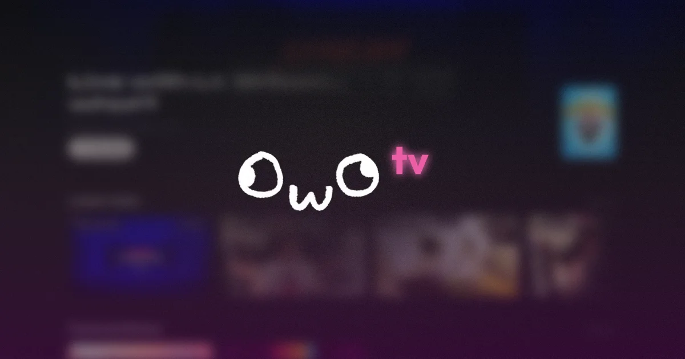

<div align="center">



# owoTV

A project to archive past VODs from Twitch.

</div>

## About this repo.

owoTV is a self-hosted VOD archive for Twitch streams, complete with chat replay, sorting by date or game, and keyword searching. Videos are embedded from YouTube, and the chat is replayed right alongside them.

This project is open source and available under the [MIT License](LICENSE) - modify it to your heart's content.

## How does it work?

Everything runs on a single Cloudflare Worker, which keeps it _technically_ completely free to host:

- **The site** is built with Astro and served straight from the Worker.
- **The data** lives in D1, and chat logs are stored in R2 in small chunks, so they load as you watch instead of all at once.
- **The API** handles adding and editing VODs. It has public docs at `/api/docs`, so you can build your own integrations.
- **The `owotv` CLI and TUI** do the heavy lifting: downloading chat from Twitch, creating VODs, and uploading everything.

The repo is split into `apps/web` (the site and API), `apps/cli` (the CLI and TUI), and `packages/*` (the shared code between them).

## How do I set this up?

You'll need [Bun](https://bun.sh) and a Cloudflare account.

```sh
# Clone the repo and install dependencies
git clone https://github.com/rcwowo/owotv
cd owotv && bun install

# Create the database and the chat bucket
bunx wrangler d1 create owotv
bunx wrangler r2 bucket create owotv-data
```

Put the `database_id` it gives you into `apps/web/wrangler.jsonc`, then:

```sh
# Set up the database and deploy
bun db:migrate:remote
bun run deploy

# Create a token for yourself
bun owotv token create --name me --role admin --remote

# Make the `owotv` command available anywhere
bun link
```

Now run `owotv` to open the TUI. Add your site URL and token in Settings, add your channel, and start importing streams. Every command also works without the TUI, run `owotv --help` to see them.

## How do I modify this?

I will not be providing support for forks of the project, as the license suggests, this project is as-is. But, if there is a bug, please report it either here on GitHub or on Discord, and I will do my best to attend to it.

That being said, development is super easy:

```sh
# Set up a local database
bun db:migrate:local

# Run the test server
bun dev
```
